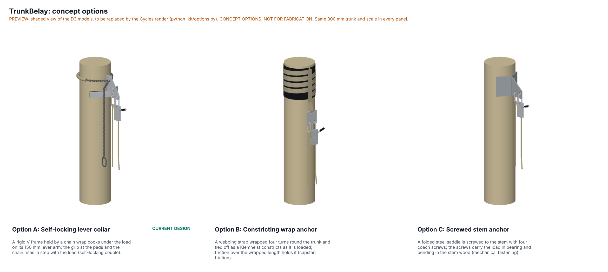

# TrunkBelay concept options

Option B, the constricting wrap anchor, scores 175 against 167 for option A, the self-locking lever collar that is the current design, and 140 for option C, the screwed stem anchor. A and B are within 10 % of each other (4.6 %), so **both go to Amish without a pick**: Proposed, awaiting Amish (TKB-DEC-001 O5, TKB-DDR-004). The repo carries option A, the constructable design of TKB-DDR-002 and TKB-DDR-003, until Amish decides; it is not redesigned without his go (STANDARDS section 21). The scores are close because B is lighter, cheaper and gentler on the palm, while A's grip does not depend on how well a knot is dressed; both rest on a friction on wet bark that nobody has measured (TKB-STM-001 S3 and B1). Method: STANDARDS section 21.

*Figure 1. The three options, each modelled at detail level D3 in `cad/src/model.py` and fitted to the same 300 mm trunk, with the same descender, carabiners and rope. Until the Cycles render is made on the studio machine with `python .kit/options.py`, this file is a labelled shaded preview from `cad/src/options_preview.py`.*

> **Safety:** Every option holds a person at height. None is certified, and none is used on a person before its anchor has been proof-tested at 2.5 kN on cut trunk sections and the drill has been run with a dummy at low height.

## The options

All three share the lowering side, which is not in question: an auto-locking descender with an anti-panic function on a locking carabiner, a brake carabiner that turns the brake strand, 30 m of 11 mm semi-static rope, and the pre-rigged evacuation triangle and chest sling (TKB-DDR-001, D4 and D5). They differ in how the anchor holds on the trunk.

### Option A: self-locking lever collar (the current design)

A rigid V frame held by a chain wrap cocks under the load on its 150 mm lever arm; the grip at the pads and the chain rises in step with the load. A TIG-welded 6082-T6 aluminium frame (5 mm spine, two rubber-faced RHS bars in a 120 deg V) sits on the trunk; a 6 mm grade 80 chain wraps the trunk once and drops into two slots in the spine top, held by a keeper and a ball-lock pin. On paper it locks with a factor of 1.54 or more on every trunk from 200 to 450 mm against an assumed combined friction of 0.9, holds 2.5 kN with every frame part at 1.21 times its welded proof strength or better, and the rescuer carries 4.67 kg (TKB-CAL-001); its estimated breaking load, about 5.0 kN, is at the low end of rescue practice (TKB-DEC-001 O7). Key risks: the friction on wet bark (S3), the upward pull of R2 avoided only by the drill rule, the AC TIG welding it needs. Needs from a co-design partner: friction and proof tests on cut trunks, the timed drill, a fabricator with an AC TIG welder. Model: 64 parts (17 fasteners, 14 weld beads).

### Option B: constricting wrap anchor

A webbing strap wrapped four turns round the trunk and tied off as a Klemheist constricts as it is loaded; friction over the wrapped length holds it. A 45 mm polyester anchor strap with a sewn loop is wrapped in a tight helix over a 3 mm rubber bark mat; the top tail runs down over the wraps, through the bottom eye, and its loop passes through the top slot of an aluminium rigging plate, which carries the load and brake carabiners. On a capstan estimate the wraps hold about 3.8 times the load with a friction of 0.3 (B1), the strap's rating class is 12 to 18 kN (B2) and the wraps press the bark at about 0.2 MPa (B3). The anchor weighs about 1.6 kg (model), so the rescuer would carry about 3.1 kg. Key risks: how a friction hitch tightens and creeps round a large, wet, tapering trunk under an axial pull, which no cited source covers; a wrongly dressed hitch; untying it once loaded; rated anchor straps are rated for a pull across a structure, not along it. Needs from a partner: slip tests of the wrap on cut trunks wet and dry, and a knot-tying trial with climbers. Model: 25 parts.

### Option C: screwed stem anchor

A folded steel saddle is screwed to the stem with four coach screws; the screws carry the load in bearing and bending in the stem wood. A galvanised 6 mm steel V saddle (the same 120 deg V as option A) is held by four M10 x 120 coach screws with washers, driven by hand at height, and a 10 mm eye lug welded to its ridge carries the carabiners. On timber formulas four screws hold about 35 kN (C1), but palm stem tissue is not timber; the four holes are permanent wounds in the palm and fail PR-008 by design (C2); driving the screws is estimated at about 8 minutes (C4). The anchor weighs about 4.8 kg (model) plus a ratchet brace and bit, so the rescuer would carry about 7 kg. Key risks: pull-out in soft palm tissue, harm to the palm, a tool at height. Model: 34 parts (17 fasteners, 2 weld beads).

## First-order numbers

Table 1. Options compared.

| Quantity | Option A | Option B | Option C |
| --- | --- | --- | --- |
| Estimated parts cost (USD) | 828 (BOM) | About 730, plus a rigging plate and the strap's sewing, to assess (A less its USD 162 of collar and chain, plus a strap at the BOM's webbing rate and a mat at the BOM's rubber rate) | To assess: A less USD 162, plus a fabricated galvanised saddle and lug, four coach screws and a ratchet brace and bit |
| Anchor mass, from the model (kg) | 3.1 (frame, pads, fixings, chain set) | 1.6 (strap 0.2, mat 1.0, plate 0.4) | 4.8 (saddle 2.8, lug 1.5, screws) |
| Carried up the trunk (kg) | 4.67 (TKB-CAL-001 [F2]) | About 3.1 | About 7, with the tool |
| Anchor holding, on paper | Locking factor 1.54 at 200 mm on assumed friction 0.9 (S3, plausible) | About 3.8 times the load on a capstan estimate (B1, plausible) | About 35 kN on timber formulas, not valid for palm (C1, plausible) |
| Rigging time (estimate) | About 4.5 min | About 5 min (the wrap about 90 s) | About 12 min (screws about 8 min) |
| Harm to the palm | Pads 1.9 MPa against 9.3 MPa crushing; bare links mark about 0.3 mm | About 0.2 MPa under the wraps | Four permanent 10 mm holes each use |
| Parts in the model (fasteners, welds) | 64 (17, 14) | 25 (9, 0) | 34 (17, 2) |
| STEM check | 19 within, 13 plausible (S30 since Amish's decision O7 of 2026-10-25: test to failure first) | 2 within, 2 plausible | 1 within, 3 plausible |

## Scoring

Table 2. Weighted scoring against TKB-URS-001 (weights: High 3, Medium 2, Low 1; scores 1 to 5).

| Criterion | Source | Weight | A | B | C | Reason |
| --- | --- | --- | --- | --- | --- | --- |
| Holds the person on a wet, fibrous trunk | UR-001 | 3 | 4 | 3 | 3 | A's lock does not depend on how hard the chain was pulled; B's hold depends on the hitch tightening; C's screws on unknown palm embedment |
| Stays secure if the load direction shifts | UR-002 | 3 | 2 | 2 | 4 | A holds only a downward pull (drill rule); a Klemheist holds one way only; screws hold both ways |
| Fits 200 to 450 mm palms without tools | UR-003 | 3 | 5 | 5 | 2 | Chain and V, or strap, fit the range; C needs a drill or ratchet |
| Rigged and the victim clipped within minutes | UR-004 | 3 | 3 | 3 | 1 | About 4.5 and 5 minutes; C about 12 |
| Lowered under control | UR-005 | 3 | 4 | 4 | 4 | Same descender and brake carabiner |
| Reaches the ground from the tallest palms | UR-006 | 3 | 5 | 5 | 5 | Same 30 m rope |
| Light enough to carry up hands-free | UR-007 | 3 | 3 | 5 | 1 | 4.67, about 3.1 and about 7 kg |
| Does not harm the palm | UR-008 | 2 | 4 | 5 | 1 | Pads and sleeve; light wraps; permanent holes |
| Affordable for a climber group (and against the USD 900 value-engineering target) | UR-009 | 2 | 3 | 4 | 3 | USD 828; about USD 730 plus items to assess; to assess |
| Learnable in a half-day session | UR-010 | 2 | 3 | 2 | 3 | A clip-on frame; a hitch that must be dressed right under stress; screwing is familiar |
| Stops the person if the rescuer lets go | UR-011 | 3 | 5 | 5 | 5 | Same auto-locking descender |
| Holds the person head up once freed | UR-012 | 3 | 4 | 4 | 4 | Same victim set |
| Survives heat, humidity and monsoon storage | UR-013 | 2 | 3 | 3 | 4 | Bare aluminium against steel; polyester and rubber in sun; galvanised steel |
| Wear parts inspected and replaced locally | UR-014 | 1 | 4 | 4 | 3 | Pads and sleeve; strap and mat; screws and saddle |
| Fits rescue practice; not passed off as certified | UR-015 | 2 | 3 | 3 | 2 | A custom collar; a rated strap used outside its rating; screwing into a living palm is not anchor practice |
| Buildable and repairable by a local fabricator | UR-016 | 2 | 3 | 5 | 4 | A needs an AC TIG welder; B is bought; C needs steel welding and galvanising |
| Free to build and share as open hardware | UR-017 | 2 | 4 | 5 | 5 | A keeps clear of the Cynch-Lok cinch by design; B and C use generic hardware |
| Safety (failure modes and their severity) | PRB, RSK | 3 | 4 | 3 | 2 | A fails slowly by settling; B by a badly dressed or creeping hitch; C by pull-out in soft tissue and a tool at height |
| **Weighted total** | | | **167** | **175** | **140** | B 100 %, A 95.4 %, C 80 % |

Cost against the value-engineering target is scored once, in the UR-009 row, so it is not counted twice; buildability is the UR-016 row and maintenance the UR-014 row.

## Recommendation

**No pick: options A and B go to Amish together** (within 10 %), recorded as Proposed, awaiting Amish in TKB-DEC-001 (O5) and argued in TKB-DDR-004. Option C is not recommended: it is heavy, slow, needs a tool at height and wounds the palm on every use.

- **If option A is kept** (the current, constructable design), B's best idea to graft onto it is its light wrap: about 1.9 kg of the 4.67 kg carried is chain. A webbing wrap in place of most of the chain loop could take the carried mass to about 3 kg, but only with a cleat that holds webbing without a ratcheting cinch (the Cynch-Lok design-around); to be studied only if Amish asks.
- **If option B is chosen**, A's best idea to graft onto it is the rigid V with rubber pads under the load point, so the hitch does not have to hold a point load against the bark; and B would need its own constructable design, calculation note, drawings and build plan (a new TRL 3 step).
- **Either way**, the first test is the same: friction and slip of the anchor on cut, wet coconut trunk sections at 2.5 kN.

## Option claims in the STEM check

Option A: TKB-STM-001 rows S1 to S32. Option B: B1 to B4. Option C: C1 to C4. No option has a Fails row.
